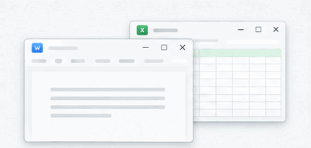
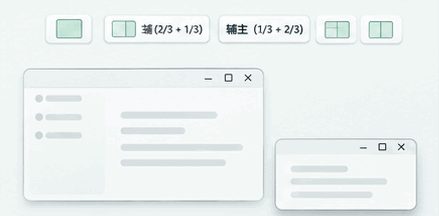

  
  <h1>PaneSet</h1>
  
<strong>Quickly gather windows to compare, pick a screen, and tile them in one go — restore with a single shortcut when you're done.</strong>

  
English | <a href="README_zh.md">简体中文</a>

  
 
  Concept demo (generated illustration, not a real screen capture)

  

    When you have a cluttered desktop and just need to cross-reference two or three documents, dragging and resizing windows one by one is tedious. 
    PaneSet doesn't force you into rigid window management rules or pre-configured workspaces: pick what you need right now, tile them onto any screen, and put them back when you're finished.
  

  
<em>Currently a Windows prototype (macOS planned).</em>

---

## Quick Start

For a fixed local Windows x64 preview package, see the [trial guide and known limitations (Chinese)](docs/TRIAL.md). The ZIP includes the .NET runtime; extract it and run `PaneSet.exe`.

To build from source, double-click [run.cmd](run.cmd) in the root directory.

- **First Run**: Automatically sets up a local, portable .NET toolchain without requiring global SDK installation.
- **Subsequent Runs**: Brings the existing instance to the foreground rather than launching duplicate processes.
- **Exit**: Click "Exit" in the panel to quit completely and release all registered global hotkeys.

---

## How to Use

### 1. Core Workflow: Pick & Tile Across Displays

 Concept demo (generated illustration, not a real screen capture)

1. **Open Panel**: Press `Ctrl+Alt+Space` to summon the main panel (the currently active window is pre-selected).
2. **Select Windows**: Check the windows you want to compare (supports multiple screens; search by app name or window title; numbers indicate layout order).
3. **Choose Layout**:
   - Supports **Side-by-side** (`Alt+1`), **Main + Sidecars** (`Alt+2`), **Grid** (`Alt+3`), or **Auto** (splits 2–3 windows, grids 4+).
   - Live layout preview updates on the right; press `Alt+S` to cycle window order.
4. **Tile**: Select your target display and press `Enter`. Windows move into place immediately, and the panel tucks away.
5. **One-Click Restore**: Done comparing? Press `Ctrl+Alt+Z` (or click "Restore last layout" in the panel) to instantly return all affected windows to their original positions, sizes, and screens.

### 2. Single-Screen Shortcuts (Fast Path)

 Concept demo (generated illustration, not a real screen capture)

If you only need to organize windows on your active screen without opening the full panel:
- **`Ctrl+Alt+1` (Auto Tile)**: Instantly tiles all visible windows on the active screen.
- **`Ctrl+Alt+2` (Thumbnail Quick Pick)**: Opens a compact thumbnail grid for the current screen. Even windows buried completely behind others can be spotted and selected visually. Press `Enter` to tile, or `Esc` to cancel.

### 3. Drag to Place (Single Window)

 Concept demo (generated illustration, not a real screen capture)

Hold the assist key (default `Shift`, customizable) and drag any window's title bar: drop zones and a strip of six layout-template thumbnails appear on the screen under the pointer — equal columns, thirds, main-side and its mirrored variant, stacked rows, and a 2×2 grid. Sweep a thumbnail to switch templates, release the mouse to drop the window into the highlighted zone. Only the dragged window moves; whatever occupied the zone stays behind.

### 4. Tweak the Previous Selection (Recent Group)
If you want to swap the order or switch the layout of the windows you just arranged, open the panel and click **"Tweak Recent Group"** to reload the last members and settings without hunting for windows again.

---

## Hotkey Reference

Global hotkeys can be customized or disabled under **Settings** in the main panel (configuration is saved in `%LOCALAPPDATA%/PaneSet/settings.json`).

| Scope | Shortcut | Description |
| --- | --- | --- |
| **Global** | `Ctrl+Alt+Space` | Summon / hide the main PaneSet panel |
| **Global** | `Ctrl+Alt+Z` | Restore windows to their pre-tiling state |
| **Global** | `Ctrl+Alt+1` | Auto-tile all windows on the current screen |
| **Global** | `Ctrl+Alt+2` | Open thumbnail quick-pick for the current screen |
| **In Panel** | `Alt+1 / 2 / 3` | Preview layouts: Side-by-side / Main + Sidecars / Grid |
| **In Panel** | `Alt+S` | Cycle window order (swap pairs or move #1 to end) |
| **In Panel** | `Ctrl+F` | Focus search box |
| **In Panel** | `Tab` / `Space` | Navigate focus / Toggle selection |
| **In Panel** | `Enter` | Confirm and tile windows |
| **In Panel** | `Esc` | Hide panel (or cancel quick-pick selection) |

> **Note**: If an application enforces its own minimum window size and cannot shrink further, consider switching to a grid layout or selecting fewer windows.

---

## Architecture & Verification

- **Tech Stack**: C# / .NET 10, WPF, Win32 API (no external third-party runtime dependencies).
- **Project Structure**: Main application lives in [src/PaneSet](src/PaneSet/PaneSet.csproj); automated checks and tests are in [tests/PaneSet.Checks](tests/PaneSet.Checks/PaneSet.Checks.csproj).
- **Run Verification**: Double-click [verify.cmd](verify.cmd) to execute layout math tests and live controlled-window interaction suites.
- **Test Details**: Real-world screenshots, system environment notes, and test records can be found in [Validation Log](docs/VALIDATION.md).

---

## Documentation

| Document | Purpose |
| --- | --- |
| [Product Definition](docs/PRODUCT.md) | Core problem statement, product scope, and principles. |
| [Windows Architecture Plan](docs/WINDOWS_PLAN.md) | Window filtering, layout algorithms, coordinates, and restoration. |
| [Research & References](docs/REFERENCES.md) | Competitive analysis and native Windows API research. |
| [Setup Review](docs/SETUP_REVIEW.md) | Test environment baselines and project configuration. |
| [Validation Log](docs/VALIDATION.md) | Test runs, screenshots, and verified boundaries. |
